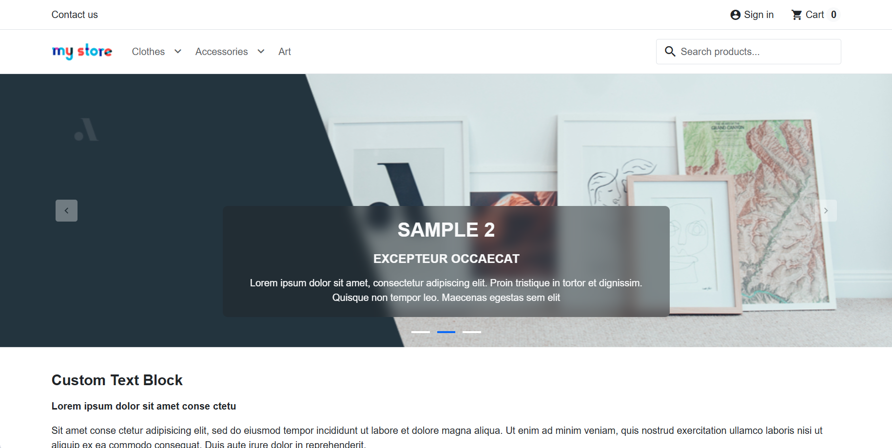
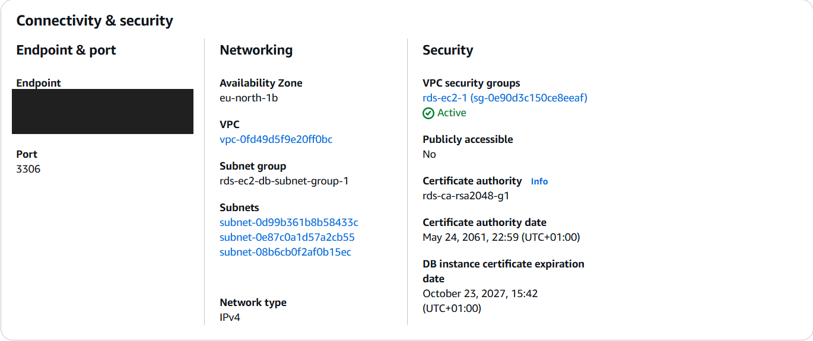
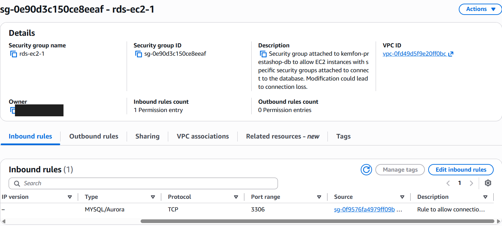

# PrestaShop Deployment on AWS

## Overview

I deployed a working PrestaShop demo store on AWS, using an EC2 instance for the website and a separate Amazon RDS MySQL database.

I completed this deployment as a technical assessment and documented it as a learning project. I used external learning resources, documentation and AI guidance for configuration, command syntax and troubleshooting. I checked the deployment through the AWS console, server commands and browser tests.

## What I Built

- An Ubuntu EC2 instance running Apache, PHP and PrestaShop.
- A separate RDS MySQL database with public access disabled.
- Security group rules controlling access to the website, SSH and database.
- A dedicated database user for the application.

## Architecture

Visitors connect to the PrestaShop website hosted on EC2. The application connects to the RDS database over the private network within the same VPC.

| Component | Purpose |
| --- | --- |
| Amazon EC2 | Hosts the website and application |
| Ubuntu 24.04 LTS | Server operating system |
| Apache | Web server |
| PHP 8.3 | Runs the application |
| PrestaShop 9.2.0 | Demo e-commerce application |
| Amazon RDS for MySQL | Separate database server |
| Security groups | Control network access |

## Deployment Process

1. Created an Ubuntu EC2 instance and configured its security groups.
2. Created an RDS MySQL database with public access disabled.
3. Allowed database connections on port 3306 from the EC2 application's security group.
4. Connected to EC2 using SSH.
5. Installed Apache, PHP and the required PHP extensions.
6. Added swap space to support installation on the small instance.
7. Downloaded and extracted PrestaShop.
8. Configured an Apache virtual host for the application.
9. Created the application database and a dedicated database user.
10. Completed the PrestaShop browser installer.
11. Removed the installation directory.
12. Verified that the storefront and administration dashboard loaded.

## Security Configuration

- Restricted SSH access to my public IP address at the time of setup.
- Kept the RDS database private.
- Restricted inbound database traffic to the application's security group.
- Used a dedicated application database user instead of the database administrator account.
- Enabled encryption at rest for the EC2 storage and RDS database.
- Verified a MySQL command-line connection using TLS certificate validation.
- Removed the PrestaShop installation directory after installation.

The command-line TLS check does not confirm that the application's database connection uses TLS. That requires separate verification.

## Troubleshooting

### Database certificate validation

The MySQL client initially could not find the required certificate bundle. I downloaded the AWS RDS certificate bundle and used it to verify the database connection.

### Database credentials

I corrected a database user password configuration issue, checked the user's permissions and tested the connection before continuing with installation.

### Limited server memory

I added swap space to help the small EC2 instance handle the installation.

### Administrator access

I used the PrestaShop command-line password reset tool to restore access to the administration dashboard.

## Verification

- The storefront loaded with demo products.
- The administration dashboard was accessible.
- The storefront returned an HTTP 200 response.
- The installation directory was removed.
- RDS public access was disabled.
- The database security group allowed MySQL traffic from the application's security group.

## Cybersecurity Relevance

This project gave me practical experience with network access controls, database access, server configuration and troubleshooting.

I built on this deployment by analysing its Apache access and error logs in a [web server log investigation](https://github.com/kemfon-edet/web-server-log-investigation), examining suspicious requests and preserving relevant evidence.

## Limitations and Improvements

This was a learning deployment, and it needs further work before production use.

- HTTPS was not configured; the website used HTTP.
- Application-to-database TLS still needs verification.
- Centralised logging and security alerts have not been configured.
- Backup restoration has not been tested.
- Further work is needed on patching, hardening and credential management.

## What I Learned

I learned how a web application connects to a separate database, how security groups control traffic and how to investigate installation problems step by step.

Key lessons included why the database should remain private, how security groups restrict database traffic to the application server, and why the application should use a dedicated database user.

## Next Steps

- Configure HTTPS.
- Verify encrypted application-to-database connections.
- Collect and analyse web server logs.
- Practise detecting suspicious requests and failed login attempts.
- Review AWS usage and remove resources when they are no longer needed.

## Project Screenshots

### Working Storefront

The PrestaShop demo storefront after installation.

### Private Database Configuration

RDS configuration showing that public access is disabled. The database endpoint has been hidden.

### Database Access Rule

The database security group permits MySQL traffic on port 3306 from the application's security group. The AWS account number has been hidden.

## Technical Deployment Notes

See the [deployment notes](deployment-notes.md) for the Linux commands, Apache configuration, database setup and verification steps.

### Apache Web Log Investigation

Investigated suspicious requests targeting potential backups and data exports. Correlated access and error logs, documented findings and preserved evidence with SHA-256 integrity checks.

[Explore the investigation](https://github.com/kemfon-edet/web-server-log-investigation)
